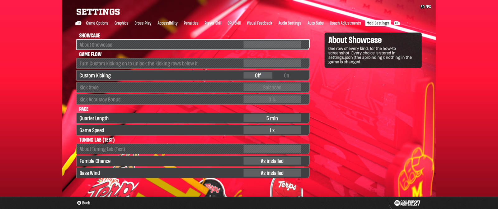
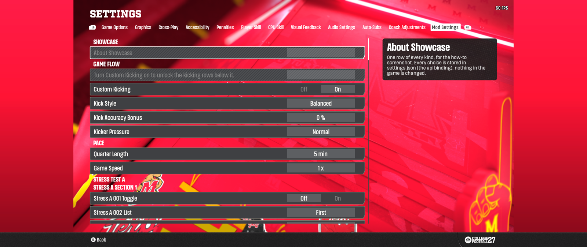
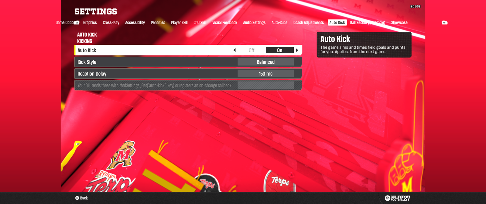
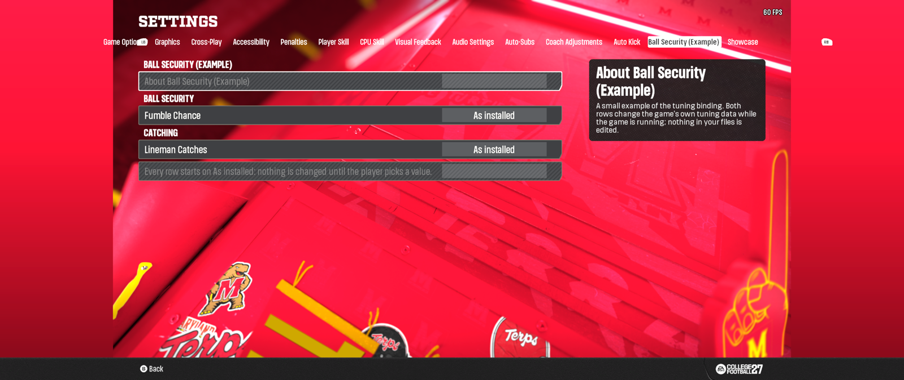
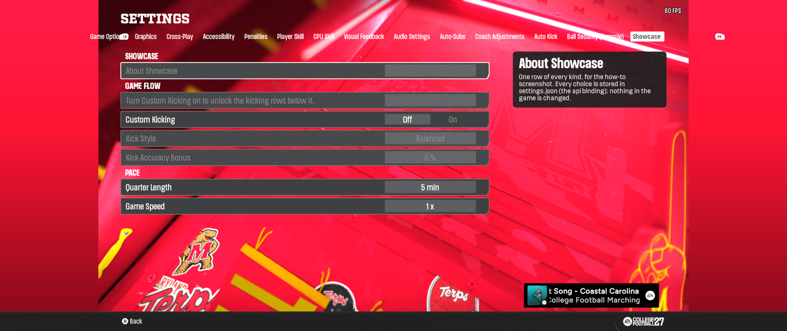
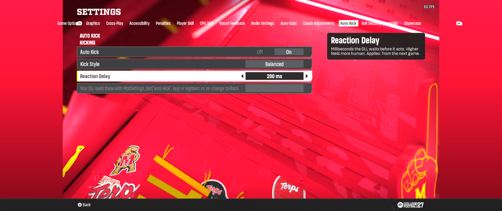

# CFB 27 Mod Menu (Mod Settings)

One in-game **Mod Settings** tab for every installed mod. A modder writes a small JSON manifest (no code); players get a settings page
for it, and the DLL applies the choices. Status: **beta 0.1 released**. Download: [releases/latest](https://github.com/sdmart3/cfb27-mod-menu/releases/latest).

- `docs/how-to.md`: start here (what each binding does, one example each, joining sections, troubleshooting)
- `docs/manifest-spec.md`: the manifest format (schema v3)
- `docs/design.md`: how it works and why
- `dll-plugin/`: the plugin DLL (C), the Mod Manager plugin loader (C#), the companion page, packaging tools
- `tab/`: the generator for the in-game tab (.fbmod)
- `tools/validate.js`: manifest validator
- `samples/`: example manifests

## What it looks like in game

### 0.1: one Mod Settings tab

Made by [`samples/showcase.json`](samples/showcase.json). Custom Kicking Off: the two kicking rows are greyed and Kicker Pressure is hidden.



Custom Kicking On: the kicking rows are live and Kicker Pressure appears.



<details>
<summary>The JSON behind these two screenshots (samples/showcase.json)</summary>

```json
{
  "schema": 3,
  "modid": "showcase",
  "title": "Showcase",
  "version": "1.0.0",
  "about": "One row of every kind, for the how-to screenshot. Every choice is stored in settings.json (the api binding); nothing in the game is changed.",
  "rows": [
    { "type": "header", "label": "Game Flow" },
    { "type": "info", "label": "Turn Custom Kicking on to unlock the kicking rows below it." },
    {
      "type": "toggle", "key": "custom-kicking", "label": "Custom Kicking",
      "description": "On: the kicking rows below apply. Off: they are greyed and the game kicks as normal.",
      "default": false, "bind": { "type": "api" }
    },
    {
      "type": "list", "key": "kick-style", "label": "Kick Style",
      "description": "How the kicker plays field goals and punts.",
      "options": ["Safe", "Balanced", "Aggressive", "Squib"], "default": 1, "bind": { "type": "api" },
      "enabledIf": { "key": "custom-kicking", "eq": true }
    },
    {
      "type": "slider", "key": "kick-accuracy", "label": "Kick Accuracy Bonus",
      "description": "Added to the kicker's accuracy, in percent.",
      "min": 0, "max": 100, "step": 5, "default": 0, "unit": " %", "bind": { "type": "api" },
      "enabledIf": { "key": "custom-kicking", "eq": true }
    },
    {
      "type": "list", "key": "pressure", "label": "Kicker Pressure",
      "description": "Shown only while Custom Kicking is on: how much a loud crowd rattles the kicker.",
      "options": ["None", "Light", "Normal", "Heavy"], "default": 2, "bind": { "type": "api" },
      "visibleIf": { "key": "custom-kicking", "eq": true }
    },
    { "type": "header", "label": "Pace" },
    {
      "type": "list", "key": "quarter-length", "label": "Quarter Length",
      "description": "A longer list: eight choices.",
      "options": ["1 min", "2 min", "3 min", "5 min", "7 min", "10 min", "12 min", "15 min"], "default": 3, "bind": { "type": "api" }
    },
    {
      "type": "slider", "key": "game-speed", "label": "Game Speed",
      "description": "A slider with a decimal step, from 0.5 x to 2.0 x.",
      "min": 0.5, "max": 2.0, "step": 0.1, "default": 1.0, "unit": " x", "bind": { "type": "api" }
    }
  ]
}
```

</details>

### Coming in 0.2: one tab per mod

Tested in game with a test build of the tab and the 0.1 plugin; not in the 0.1 download yet. Each mod gets its own tab, named from its JSON. These are the three samples, one tab each:

**Auto Kick:** [`samples/dll-mod-sample.json`](samples/dll-mod-sample.json) (an `api` mod).



**Ball Security (Example):** [`samples/ball-security.json`](samples/ball-security.json) (`tuning` rows, shown As installed).



**Showcase:** [`samples/showcase.json`](samples/showcase.json), the same file as the 0.1 shots above.



A choice changed inside a mod's tab is saved like any other (Reaction Delay 150 ms to 200 ms):



## Modder quick start

One toggle:

```json
{
  "schema": 3,
  "modid": "my-mod",
  "title": "My Mod",
  "version": "1.0.0",
  "rows": [
    { "type": "toggle", "key": "lineman-catch", "label": "Lineman Catches", "default": false,
      "description": "On: linemen may catch passes thrown their way.",
      "bind": { "type": "tuning", "asset": "catching", "copy": "both",
                "field": "shouldLinemanMultiplayerCatch", "values": [false, true] } }
  ]
}
```

Two ways to deliver it:

1. **JSON file:** `Plugins\ModSettings\mods\<modid>.json`.
2. **Description block:** paste the JSON into your .fbmod description between `[[MODSETTINGS` and `MODSETTINGS]]` (planned; 0.1 reads files only).

Check it (Node.js required):

```
node tools/validate.js my-mod.json
```

Errors say what is wrong and how to fix it. See `docs/manifest-spec.md` for every row type and binding.

Good to know before you publish: your `modid` should be unique (a second mod with the same id is kept but its settings are stored as `modid@file`), a duplicate row `key` in one manifest means the first wins, and a manifest can add rows to another mod's section by naming that section. The new spec sections "Names/duplicates", "Adding rows to another mod's section" and "Safety and behaviour rules" cover it.

## Building

No binaries are committed. This repo carries no EA game files either.

- **DLL:** `node dll-plugin/dll/build.js` (needs a C toolchain; the build also reads game memory images for pin generation, which are
  not included: set `MS_ROOT` to a folder holding `reference/memimage-tu-10-13.bin` and `reference/memimage-tu-10-29.bin`, or use `--no-test`
  once `ms_pins.h` is already generated, as it is here).
- **Plugin loader:** `dll-plugin/plugin/build-plugin.ps1`.
- **In-game tab (.fbmod):** the built .fbmod is not in git. `tab/src/ui-build-ms.js` edits the player's own installed
  `scriptpod.ast` at build time. The maintainers' wrapper (`build.js`) depends on private tooling and is not included yet, so
  building the tab from this repo alone is not turnkey; the generator, manifests and emulator tests are here for reading and review.

## Contributing

See `CONTRIBUTING.md`.
