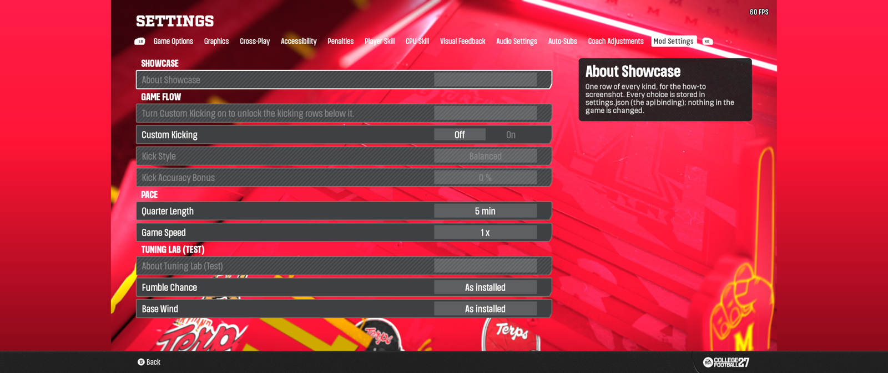
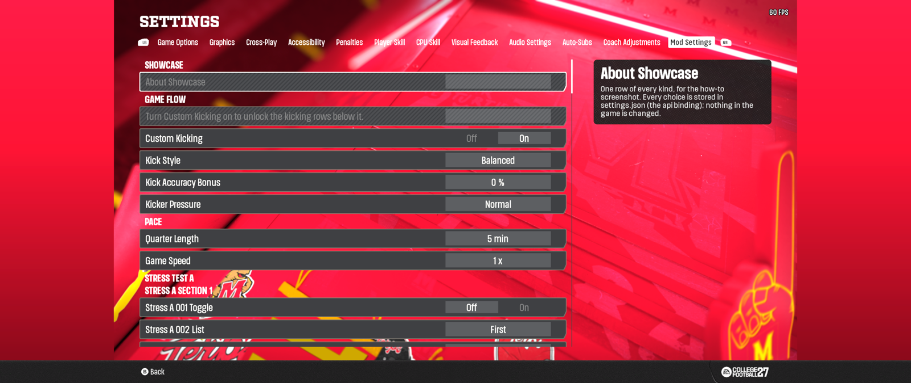

# Mod Menu 0.1 (beta): one settings tab for every mod

Mod Menu adds a **Mod Settings** tab to the game's Settings screen. You describe your mod's options in one JSON file, no code, and players get switches and choices for them in game. Offline play only. It needs College Football 27 at the 2026-10-29 or 2026-10-13 update and the Mod Manager (the plugin loads when you press Launch there). A mod that does not use it is not affected, and your mod keeps working on its own defaults for players who do not have Mod Menu.

## Install

The beta package (DLL, loader, tab .fbmod, validator, samples) is built from this repo; no binaries are committed here. Install steps ship with the package: copy its `Plugins` folder into the Mod Manager folder, import `Mod Settings Tab (Test).fbmod`, launch from the Mod Manager, then Settings and RB to **Mod Settings**.

## Add a section for your mod

Write one JSON file named `<your-mod-id>.json` and ship it with your mod. Players drop it into `Plugins\ModSettings\mods\` (the folder that holds the two examples). What each part of `bind` means is under "The three bindings" below.

```json
{
  "schema": 3,
  "modid": "my-mod",
  "title": "My Mod",
  "version": "1.0.0",
  "rows": [
    { "type": "toggle", "key": "lineman-catch", "label": "Lineman Catches", "default": false,
      "description": "On: linemen may catch passes thrown their way.",
      "bind": { "type": "tuning", "asset": "catching", "field": "shouldLinemanMultiplayerCatch",
                "copy": "both", "values": [false, true] } }
  ]
}
```

- `modid` is permanent: lowercase letters, digits and `-`. Players' choices are saved under it. `<yourname>-<modname>` keeps it unique.
- Row types: `toggle` (`default` is `true` or `false`), `list` (2 to 12 `options`; `default` is the position from 0), `slider` (`min`, `max`, `step`, optional `unit`; `default` is a value between `min` and `max`), `header` and `info` (text only).
- Every toggle, list and slider row needs a `key` (permanent, unique in the file), a `default`, a `bind` and a one-sentence `description` written for players.
- `applies` says when a change takes effect: `now`, `next-game` (the default) or `restart`.
- Check the file before you ship it. It needs Node.js: open a terminal in this folder and run `node tools/validate.js path\to\my-mod.json`. Every message says which row is wrong and how to fix it.

## Where to store a setting

Use the normal (global) storage by default: leave the `bind` as `api` or `tuning` and the choice is kept in `Plugins\ModSettings\settings.json`, one value per player, whatever dynasty is loaded. There is plenty of room.

Use the `dynasty` binding only for a setting that must be different in each dynasty. A dynasty save has room for only about 18 Mod Menu settings in total, shared by ALL mods, so spend it on things that really need it.

Limits, in plain words:
- 64 mods (manifests) at most.
- Keep the whole tab to about 100 rows across all mods (headers, text rows and each section's About row count). Tested in game: 116 rows draw fine; with 216 rows the game's Settings screen does not draw at all. The plugin itself accepts more, but the game's menu does not. One manifest holds up to 120 rows.
- A list row has 2 to 12 options.
- A slider has up to 1001 steps.

What `samples/showcase.json` looks like in game. Custom Kicking Off: the two kicking rows are greyed and Kicker Pressure is hidden.



Custom Kicking On: the kicking rows are live and Kicker Pressure appears.



## The three bindings

A `bind` says what a row does. Pick one per row.

**`tuning`**: changes the game's own tuning data while the game runs, for values the game's own settings do not reach (the ones gameplay mods edit). Nothing in any file is edited and the game goes back to its normal values the next launch without Mod Menu.

```json
{ "type": "list", "key": "jump-offsides", "label": "Jump-the-Snap Offsides", "options": ["Rare", "Stock", "Often"], "default": 1, "applies": "next-game",
  "description": "How often defenders jump the snap and draw offsides.",
  "bind": { "type": "tuning", "asset": "penalties", "field": "offsides_penalties_jump_the_snap_number_desired_per_game", "copy": "both", "values": [0.5, 2.0, 4.0] } }
```

`copy` is required: the game keeps a Simulation copy and a base copy of tuning data, and only you know which one your mod edits (`simulation`, `base`, or `both` if unsure). It writes numbers and switches only. A `slider` uses `"scale": { "at-min": 0, "at-max": 1 }` instead of `values`, and `"instance"` picks one value inside a list or curve (`"[3]"`, `"Points[1].Y"`). Every tuning row gets an extra first choice, **As installed**, that changes nothing and is the default, so your .fbmod's own values are what plays until the player picks something. Players should set tuning rows from the main menu, before a game starts; test your field in a game before you ship.

**`api`**: for a mod that is itself a DLL. The value is stored in `Plugins\ModSettings\settings.json`; your DLL reads it with the one function this build exports:

```c
typedef int (*ms_get_fn)(const char *modid, const char *key);
HMODULE m = GetModuleHandleA("modsettings.dll");
ms_get_fn get = m ? (ms_get_fn)GetProcAddress(m, "ms_get") : NULL;
int v = get ? get("auto-kick", "style") : -1;   // -1: no Mod Menu or no such row, use your own default
```

A toggle gives 0 or 1, a list its position, a slider its stop number. You can also just read `settings.json`.

**`dynasty`**: for a mod made of expression files that keeps its choice in the dynasty save. The row is mirrored into a shared storage band in the loaded dynasty and your expression reads it there. It needs a slot reserved in `Plugins\ModSettings\slots.json`: open an issue on the GitHub repo to get one before you ship, and never change it afterward. This binding has not been tested in game with this build yet.

```json
{ "type": "list", "key": "mode", "label": "Recruit Mode", "options": ["Stock", "Fast", "Slow"], "default": 0,
  "description": "How fast recruiting moves in this dynasty.",
  "bind": { "type": "dynasty", "slot": "my-mod-mode" } }
```

## Joining another mod's section, and names

- To add rows under a section you do not own, set `"section": "<that mod's modid>"` at the top of your file. Your rows appear after the owner's, under "added by <your title>". The owner may refuse with `"closed": true`; your rows then show in your own section. If that mod is not installed, your rows also show in your own section.
- A shared section anyone may join starts with `@`, for example `"section": "@penalties"`. Several mods can add to it; each gets its own sub-header.
- Sections are told apart by `modid`, not by title. The modid is cleaned up before it is compared (`My_Mod`, `my mod` and `MY-MOD` are all `my-mod`).
- Two files with the same modid and the same mod: the higher `version` is used. Same modid but different mods: both show, and the second one's choices are stored under `modid@<file name>`. Two mods with the same visible title get the file name added to each header.
- The same `key` twice in one file is an error. Renaming a `key` or `modid` after release resets that setting to its default.

## Safety rules

- Two mods that set the same tuning field: both rows say "also set by <other mod>", and the last change wins.
- A row that depends on another gets `"visibleIf"` (hidden until) or `"enabledIf"` (greyed until), for example `"enabledIf": { "key": "lineman-catch", "eq": true }` on the dependent row.
- If you list `"fbmod": "<your file name>.fbmod"`, your section is hidden while that mod is off in the Mod Manager.
- If you list `"gameVersion": <number>`, your tuning rows are never written on a different game version.
- A field or asset that cannot be found greys its row with the reason. A broken manifest is skipped with a warning; it never stops other mods' rows or crashes the game.
- Top-level `about` (up to 2000 characters), `credits` and `links` in your manifest add an "About" row to your section (formats in `docs\manifest-spec.md`).

## If something does not show up

The files named here appear in `Plugins\ModSettings\` after the first launch.

- **The tab says the plugin is not running:** you did not launch from the Mod Manager, the plugin files are missing, or the game version is not 2026-10-29 / 2026-10-13. `modsettings.log` says which. Close the game, check that `ModSettingsPlugin.dll` and the `ModSettings` folder are inside the Mod Manager's `Plugins` folder, and launch from the Mod Manager again.
- **Your section is missing:** open `modsettings-status.json` and look under `manifests` then `problems`. Each skipped file is listed with the reason. The validator finds the same errors before you start the game.
- **A tuning row is greyed:** its text says why ("not available: ..."). The log has a `tuning:` line for every field found and every write.
- **What a player chose** is in `settings.json`. Delete a key from it to go back to the default.

## What is proven

In game, on the 2026-10-29 update:
- The tab, the rows (headers, switches, lists, sliders, text), a changed value reaching `settings.json`, and the value still there after leaving and reopening Settings.
- This build with several mods at once (116 rows): About rows, greyed rows (`enabledIf`), hidden rows (`visibleIf`) and tuning rows in the same tab, as in the screenshots above.
- Tuning writes: the DLL found the fields in the loaded data, wrote a value, read it back, and put the original value back when the row went to As installed. No crash, no changes to saves.

Not yet proven:
- Delivery as a block in the .fbmod description (`[[MODSETTINGS` ... `MODSETTINGS]]`): this build reads files only. I wrote the reader and it passes its offline checks; the game test of a long description, and whether the Mod Manager keeps a long one whole, is pending. Use the file for now.
- The `dynasty` binding in this build (an earlier build proved the storage writes).

